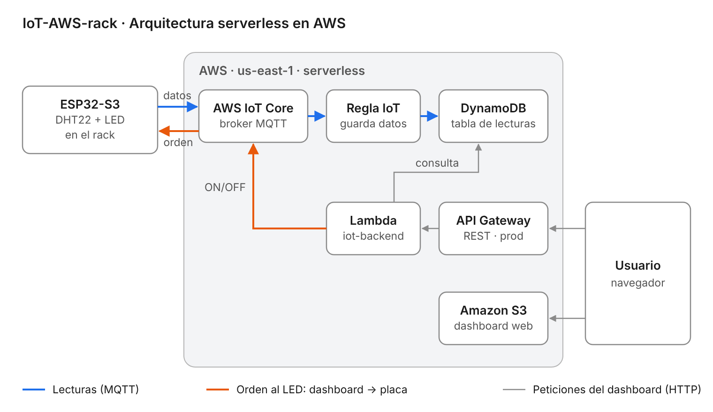
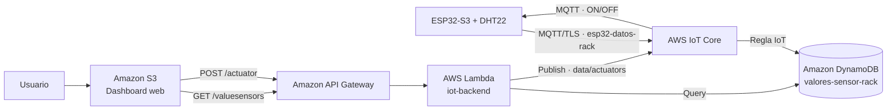

# IoT-AWS-rack · Monitoreo de temperatura y humedad de un rack de TI

**Práctica 3 — Arquitectura Serverless para IoT**  
Especialización en Inteligencia Artificial (UAO) · Inteligencia Artificial aplicada a Internet de las Cosas  
Profesor: Jhorman A. Villanueva Vivas

**Dashboard en vivo:** http://dashboard-iot-monitoreo-rack.s3-website-us-east-1.amazonaws.com

---

## 1. Caso de uso

En un cuarto de servidores, la temperatura y la humedad del rack determinan la vida útil de los equipos: el calor excesivo provoca fallas y apagados, y la humedad fuera de rango genera condensación o electricidad estática.

Este proyecto mide la temperatura y la humedad de un rack de TI con un **ESP32-S3 + DHT22**, envía las lecturas a **AWS** en tiempo real, las guarda en una base de datos y las muestra en un **dashboard web**. Desde el dashboard también se puede **activar a distancia un actuador** (el LED de la placa, que representa una alarma o un ventilador).

## 2. Arquitectura



Versión en texto (GitHub la dibuja):



| Flujo | Recorrido |
|---|---|
| **Lecturas** | ESP32 → MQTT → IoT Core → Regla → DynamoDB |
| **Consulta** | Dashboard (S3) → API Gateway `GET /valuesensors` → Lambda → DynamoDB → Dashboard |
| **Actuador** | Dashboard → API Gateway `POST /actuator` → Lambda → IoT Core (`data/actuators`) → ESP32 → LED |

Todo es **serverless**: no hay servidores que administrar; cada servicio escala solo y se cobra por uso.

## 3. Componentes

| Servicio / pieza | Función en el proyecto |
|---|---|
| **ESP32-S3-N16R8** | Lee el sensor, publica por MQTT y recibe órdenes |
| **DHT22** | Sensor de temperatura (°C) y humedad relativa (%) |
| **LED RGB integrado (GPIO 48)** | Actuador controlado desde el dashboard |
| **AWS IoT Core** | Broker MQTT seguro (TLS + certificados X.509) |
| **Regla de IoT** `save_data_dynamodb` | Toma cada mensaje del topic y lo guarda en DynamoDB |
| **Amazon DynamoDB** | Base de datos NoSQL con el histórico de lecturas |
| **AWS Lambda** | Backend: consulta DynamoDB y publica órdenes al actuador |
| **Amazon API Gateway** | Expone la Lambda como API HTTPS pública con CORS |
| **Amazon S3** | Hosting estático del dashboard |

## 4. Hardware

| DHT22 (módulo 3 pines) | ESP32-S3 |
|---|---|
| `+` (VCC) | 3V3 |
| `OUT` (DATA) | GPIO 4 |
| `−` (GND) | GND |

El LED RGB ya viene soldado en la placa (GPIO 48), no requiere cableado. El módulo DHT22 trae su resistencia de pull-up, así que no se necesita una externa.

## 5. Estructura del repositorio

```
Iot-AWS-rack/
├── firmware/
│   ├── esp32_rack/              ← firmware final (AWS + sensor + actuador)
│   │   ├── esp32_rack.ino
│   │   └── credentials.example.h   (plantilla; credentials.h NO se sube)
│   └── prueba_montaje/          ← prueba local del sensor y el LED, sin nube
├── lambda/
│   └── lambda_function.py       ← backend (GET lecturas / POST actuador)
├── dashboard/                   ← página web que se sube a S3
│   ├── index.html · styles.css
│   ├── config.js                ← URL de la API (único archivo a editar)
│   ├── api.js · ui.js · chart.js · main.js
│   └── actuator.js              ← botones Encender / Apagar LED
├── simulacion-wokwi/            ← circuito para el simulador Wokwi
├── docs/img/                    ← diagrama de arquitectura y capturas
└── README.md
```

## 6. Mensajes MQTT

| Topic | Dirección | Ejemplo de mensaje |
|---|---|---|
| `esp32-datos-rack` | ESP32 → nube | `{"timestamp":1794010155,"temperature":28.9,"humidity":73.7,"device_id":"esp32_01"}` |
| `data/actuators` | nube → ESP32 | `{"message":"ON"}` o `{"message":"OFF"}` |

`timestamp` es la hora Unix en UTC (segundos desde 1970), obtenida por NTP.

## 7. API

Base: `https://<api-id>.execute-api.us-east-1.amazonaws.com/prod`

| Método | Ruta | Descripción |
|---|---|---|
| `GET` | `/valuesensors?device_id=esp32_01&limit=100` | Últimas lecturas, de la más reciente a la más antigua |
| `POST` | `/actuator` | Body `{"message":"ON"}` u `{"message":"OFF"}` → se publica en `data/actuators` |

Respuesta de `GET`:
```json
{
  "count": 2,
  "data": [
    {"device_id": "esp32_01", "timestamp": "2026-11-06 19:20:00", "temperature": 28.9, "humidity": 73.5},
    {"device_id": "esp32_01", "timestamp": "2026-11-06 19:19:45", "temperature": 28.9, "humidity": 73.6}
  ]
}
```

---

## 8. Paso a paso

> Implementado en **AWS Academy Learner Lab** (región `us-east-1`). En este entorno no se pueden crear roles IAM, así que todos los servicios usan el rol existente **`LabRole`**.

### 8.1 Preparar Arduino IDE
1. **File → Preferences → Additional boards manager URLs**:  
   `https://espressif.github.io/arduino-esp32/package_esp32_index.json`
2. **Boards Manager** → instalar **esp32 by Espressif Systems**.
3. **Library Manager** → instalar: `DHTNEW` (Rob Tillaart), `Adafruit NeoPixel`, `PubSubClient` (Nick O'Leary), `ArduinoJson` v7 (Benoit Blanchon).
4. **Tools**: Board **ESP32S3 Dev Module** · Flash Size **16MB** · PSRAM **OPI PSRAM** · USB CDC On Boot **Disabled** · puerto COM de la placa (conector **COM** de la placa).

**Prueba local (opcional):** subir `firmware/prueba_montaje/prueba_montaje.ino`, abrir el Monitor Serie a 115200 y verificar lecturas cada 3 s; escribir `1` / `0` prende y apaga el LED.

### 8.2 AWS IoT Core: registrar el dispositivo
1. **IoT Core → Manage → Things → Create things → Create single thing** → nombre `esp32-rack1`.
2. **Auto-generate a new certificate** y descargar: certificado del dispositivo (`...-certificate.pem.crt`), llave privada (`...-private.pem.key`) y **Amazon Root CA 1**.
3. **Security → Policies → Create policy** con permisos `iot:Connect`, `iot:Publish`, `iot:Subscribe`, `iot:Receive` sobre `*` y adjuntarla al certificado.
4. **Settings** → copiar el **Device data endpoint** (`xxxx-ats.iot.us-east-1.amazonaws.com`).

### 8.3 DynamoDB y regla de IoT
1. **DynamoDB → Create table** `valores-sensor-rack`:
   - Partition key: `device_id` (String)
   - Sort key: `timestamp` (String)
2. **IoT Core → Message routing → Rules → Create rule** → nombre `save_data_dynamodb`:
   - SQL: `SELECT * FROM "esp32-datos-rack"`
   - Acción **DynamoDB** (Insert a message into a DynamoDB table): tabla `valores-sensor-rack`, partition key `device_id` (STRING) = `${device_id}`, sort key `timestamp` (STRING) = `${timestamp}`, columna de datos `payload`, operación `INSERT`.
   - Rol: **LabRole**.
3. Verificar en **IoT Core → Test → MQTT test client**, suscrito a `esp32-datos-rack`, y luego en **DynamoDB → Explore items**.

### 8.4 Firmware del ESP32
1. En `firmware/esp32_rack/`, copiar `credentials.example.h` como `credentials.h` y llenarlo con: nombre del Thing, WiFi (**2.4 GHz**), endpoint de IoT Core y el contenido de los 3 certificados.
2. Abrir `esp32_rack.ino`, subirlo y abrir el Monitor Serie a **115200**. Salida esperada:
   ```
   WiFi conectado. IP: 192.168.x.x
   Sincronizando hora... OK
   Conectando a AWS IoT... conectado
   Suscrito a data/actuators
   Enviado: {"timestamp":...,"temperature":28.9,"humidity":73.7,"device_id":"esp32_01"}
   ```

### 8.5 Lambda
1. **Lambda → Create function** → `iot-backend`, runtime Python 3.12+, rol existente **LabRole**.
2. Pegar el código de `lambda/lambda_function.py` → **Deploy**.
3. **Configuration → Environment variables**:

   | Key | Value |
   |---|---|
   | `TABLE_NAME` | `valores-sensor-rack` |
   | `IOT_ENDPOINT` | endpoint de IoT Core |
   | `ACTUATOR_TOPIC` | `data/actuators` |

4. **General configuration** → Timeout `10 s`.
5. Probar con un evento de **Test**:
   ```json
   {"requestContext": {"http": {"method": "GET"}}, "rawPath": "/valuesensors", "queryStringParameters": {"limit": "5"}}
   ```

### 8.6 API Gateway
1. **API Gateway → Create API → REST API**.
2. Recurso `/valuesensors` → método **GET** → Lambda `iot-backend` con **Lambda proxy integration**.
3. Recurso `/actuator` (con CORS) → método **POST** → Lambda `iot-backend` con **Lambda proxy integration**.
4. **Enable CORS** en `/valuesensors` (GET, OPTIONS).
5. **Deploy API** → stage `prod` → copiar el **Invoke URL**.
6. Probar en el navegador: `<Invoke URL>/valuesensors?limit=5`.

### 8.7 Dashboard en S3
1. Editar `dashboard/config.js` → `apiBaseUrl` = Invoke URL (con `/prod`).
2. **S3 → Create bucket** (us-east-1), desactivar **Block all public access**.
3. Subir los archivos de `dashboard/` (sin el README).
4. **Properties → Static website hosting** → Enable → index document `index.html`.
5. **Permissions → Bucket policy**:
   ```json
   {
     "Version": "2012-10-17",
     "Statement": [{
       "Sid": "PublicReadGetObject",
       "Effect": "Allow",
       "Principal": "*",
       "Action": "s3:GetObject",
       "Resource": "arn:aws:s3:::NOMBRE-DEL-BUCKET/*"
     }]
   }
   ```
6. Abrir el **Bucket website endpoint**.

## 9. Funcionalidades del dashboard
- Última temperatura, humedad y hora de lectura.
- Gráfica de tendencia y tabla con los últimos registros.
- **Descargar CSV** con el histórico cargado.
- **Actuador remoto:** botones Encender / Apagar LED.
- Actualización automática cada 30 s.

## 10. Verificación (criterios de evaluación)

| Criterio | Cómo se verifica |
|---|---|
| Datos en la base de datos | DynamoDB → `valores-sensor-rack` → Explore items: un registro nuevo cada 15 s |
| Conexión estable por MQTT | Monitor Serie: `Enviado: {...}` cada 15 s; MQTT test client recibe los mensajes en `esp32-datos-rack` |
| Dashboard | Muestra datos reales, descarga CSV y el botón enciende/apaga el LED de la placa |

## 11. Problemas encontrados y soluciones

| Problema | Causa | Solución |
|---|---|---|
| En Wokwi el DHT22 con ESP32-S3 devolvía error | Limitación del simulador con esta placa | Validar con hardware real (Wokwi sí funciona con ESP32 clásico) |
| Una de cada dos lecturas fallaba | DHTNEW exige ≥ 2 s entre lecturas y el código leía cada 2 s exactos | Leer cada 3 s o más |
| `credentials.h: No such file` | Arduino exige que el `.ino` y sus archivos estén en una carpeta con su mismo nombre | Mover `credentials.h` junto al `.ino` |
| Las órdenes del dashboard no llegaban al ESP32 | El firmware base atendía MQTT cada ~15 s y al reconectarse no se volvía a suscribir | `mqtt.loop()` en cada vuelta del `loop()` y `subscribe` en cada reconexión |
| Timestream no disponible | AWS cerró Timestream for LiveAnalytics a clientes nuevos (jun 2025) | Usar DynamoDB, como recomienda la actividad |

## 12. Seguridad
- `credentials.h` y los certificados **nunca** se suben al repositorio (ver `.gitignore`); se incluye `credentials.example.h` como plantilla.
- La comunicación ESP32 ↔ AWS va cifrada con TLS y autenticada con certificados X.509.
- El bucket solo permite **lectura** pública de los archivos del dashboard.
- Mejora posible: restringir el CORS de la API al dominio del bucket y limitar la política de IoT al Thing y a los topics usados.

## 13. Créditos
- Base del firmware, la Lambda y el dashboard: repositorio del profesor [jhorvi24/aws-serverless-architecture-IoT](https://github.com/jhorvi24/aws-serverless-architecture-IoT), adaptado a ESP32-S3 + DHT22, DynamoDB y control del actuador.

## 14. Equipo
- Sebastián Jiménez
- Julián Correa
- Juan Plata
- César Carabalí
